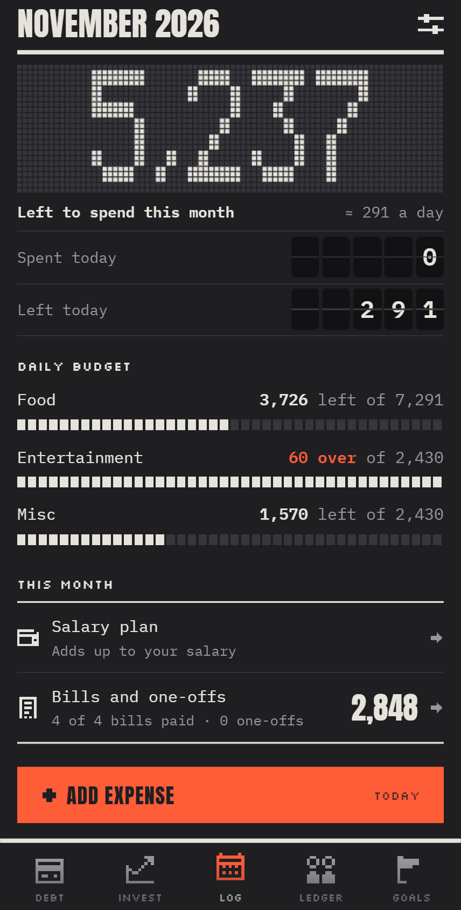
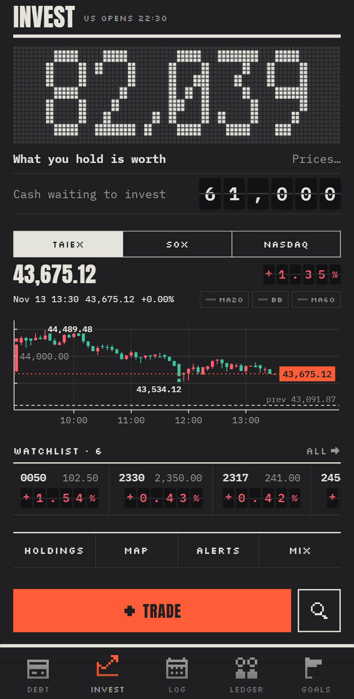
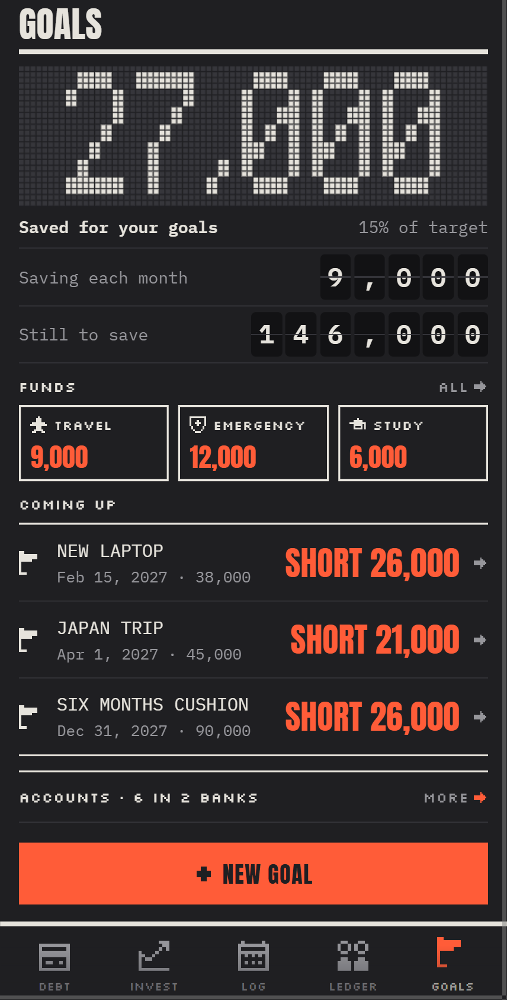
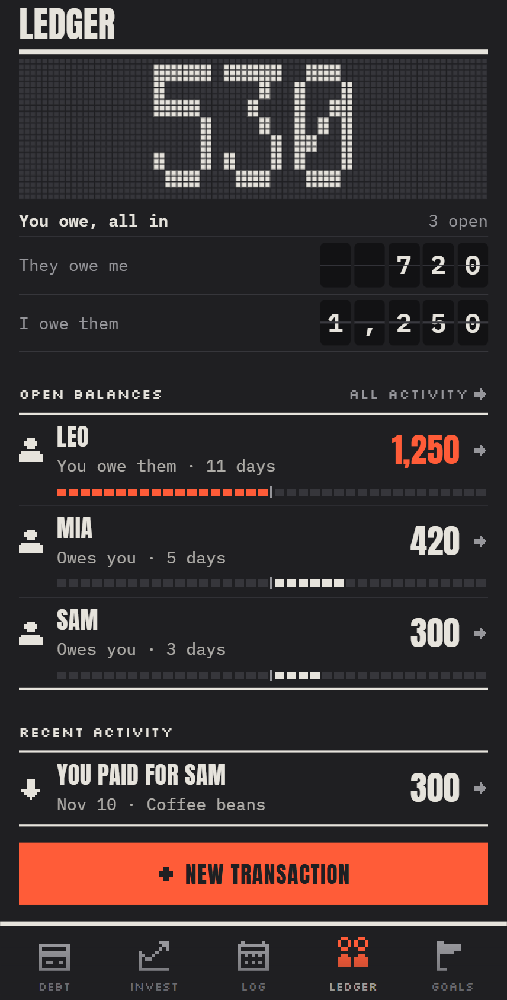

# Ledgerline

*Every part of your money in one place, kept to your own plan.*

Ledgerline is an [Obsidian](https://obsidian.md) plugin that turns plain notes into a personal finance app for your phone and desktop: a daily log and budget, debt, savings goals, a ledger with friends, and investments with live Taiwan and US prices. Everything it shows is read from, and written to, notes in your own vault: no account, no server, no database.

  
  
  
  

The demo vault: a made-up person, made-up money.

> [!NOTE]
> Early development. Not in Obsidian's community plugin list yet; the data format may still change.

## The five tabs
- **Log**: what is left to spend this month and today, daily budgets, fixed bills, the month's salary plan.
- **Debt**: a loan's balance, the repayment schedule, net worth.
- **Goals**: funds and the goals they save for, what is still short.
- **Ledger**: shared costs with friends and settling up.
- **Invest**: holdings, the target mix, live prices and charts (TWSE, Fugle, Yahoo), a market map, a watchlist marquee, alerts, and a rules check before each buy (a thesis, a cap per stock, an emergency fund first). It informs; it never blocks.

## Try it
This repository **is** a vault. Clone it and open the folder in Obsidian (*Open folder as vault*), turn on community plugins, and the app opens on the demo data.

On a phone, open it with the Obsidian Git plugin: [Start developing Ledgerline](Docs/Guide/Start%20developing.md) walks through every tap.

## Use it with your own money
Copy `.obsidian/plugins/ledgerline/` into your vault's `.obsidian/plugins/`, and copy the `Config/` notes from the demo as a starting point: each one explains its fields. Keep your vault private; sync it between devices however you like (Git, Obsidian Sync).

## Develop
The plugin's source is in `plugin/` (TypeScript, esbuild). See [CONTRIBUTING.md](CONTRIBUTING.md) for the branch flow and the build, and [AGENTS.md](AGENTS.md) if you work with a coding agent.

## License
[MIT](LICENSE). The bundled fonts (Anton, IBM Plex Mono, Silkscreen) are under the SIL Open Font License.
